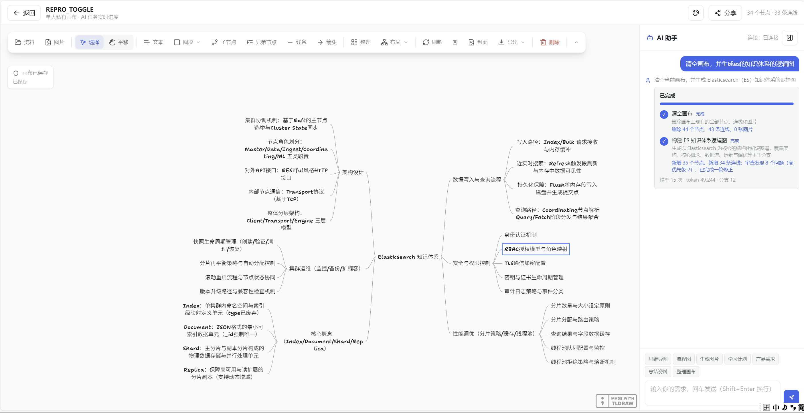
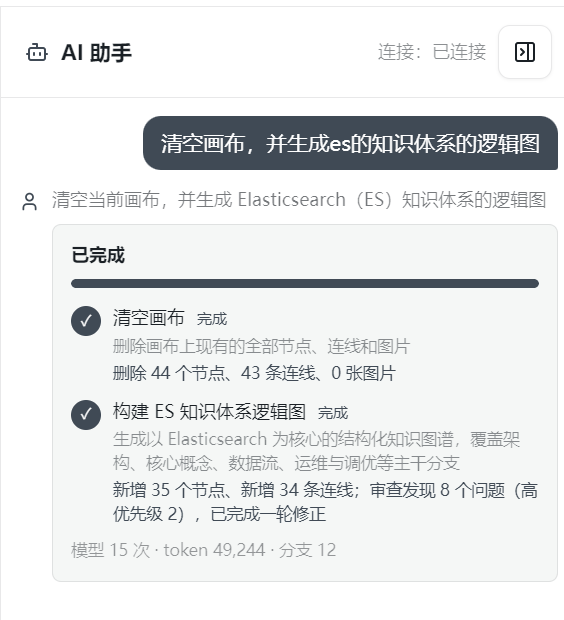
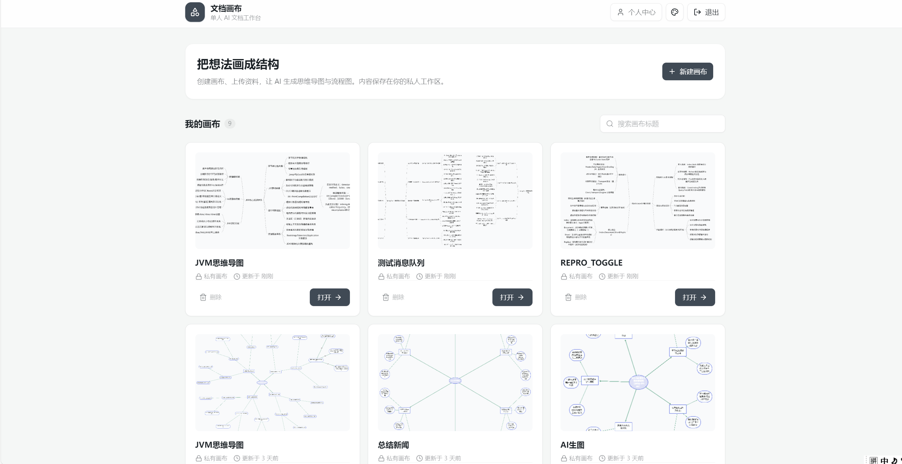
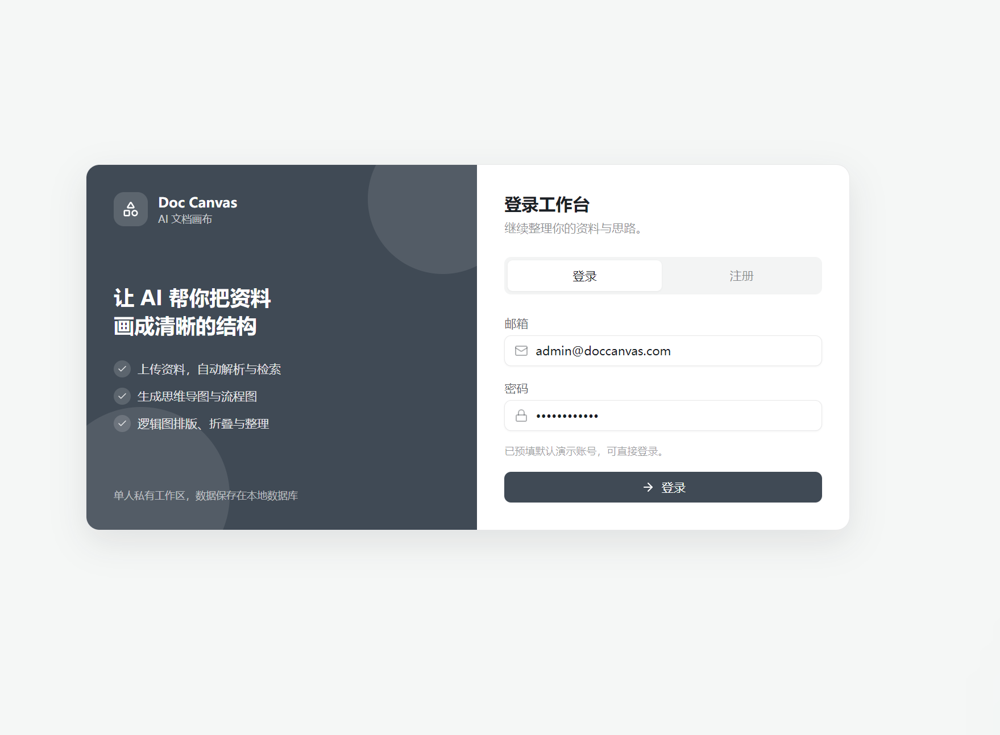

# Doc Canvas

**单人知识画布：把资料、想法和关系，整理成一张可以无限展开的图。**


[下载 Windows 便携版](https://github.com/otmyyds/canvas_-ai/releases) ·
[源码启动](#快速开始) ·
在线体验（筹备中）

仓库：[Gitee](https://gitee.com/buxiangzuoti/canvas_-ai) · [GitHub](https://github.com/otmyyds/canvas_-ai)


<sub>完整 AI 版界面：逻辑图、节点连线、属性面板与 AI 助手。</sub>

Doc Canvas 是一个面向个人使用的无限画布应用：用节点和连线组织知识，支持思维导图、逻辑图、流程图、手绘图形、图片和画布封面，支持本地保存与导出。

- 适合：个人知识整理、学习笔记、方案梳理、逻辑图与思维导图。
- 不适合：团队实时协作、正式项目管理、需要稳定 AI 产出的场景。
- AI 功能仍处于实验阶段，适合体验和辅助整理，不建议用于关键生产决策。

## 三种使用形态

| | 在线体验版（筹备中） | 本地轻量版 | 完整 AI 版 |
|---|---|---|---|
| 运行方式 | 浏览器，有限额 | 解压即用 | 源码 + Docker |
| 数据位置 | 服务端 | 本地 SQLite + 文件 | PostgreSQL + RustFS |
| AI | 不提供 | 不提供 | 实验性支持 |
| 图片上传 | 不提供 | 支持 | 支持 |
| 画布封面 | 支持 | 支持 | 支持 |
| 只读分享 | 不提供 | 不提供 | 支持 |
| 账号 | 访客身份 | 本地管理员 | 注册 / 登录 |
| 适合 | 快速看界面 | 日常个人使用 | 开发 / 完整体验 |

在线体验版只开放基础画布，AI、资料上传、RAG 和分享只在源码完整 AI 版提供。演示站目前尚未公开，README 暂不提供链接。

Windows 提供便携包；Linux 可用构建脚本自行打包，暂不提供预编译包。

## 能做什么

### 画布与布局

- 无限画布，节点、连线、图形、手绘和箭头；滚轮或中键平移。
- 树形图 / 逻辑图可切换；流程图按层级自动排布。
- 节点折叠 / 展开、同级排序；手绘图形和箭头可通过「整理」纳入结构后重排。
- 图片上传、画布封面、PNG / Markdown 导出。

### AI（仅完整 AI 版，实验性）

- 资料总结、生成思维导图 / 流程图、学习计划、产品需求等结构化内容。
- 编辑选中元素、整理画布、AI 生图、联网搜索。
- 多步骤计划、实时进度、中断与回退。
- 资料上传后分块、向量化并存入 pgvector，AI 任务可按需检索。


<sub>完整 AI 版的多步骤任务状态与结果摘要。</sub>

### 数据与导出

- 轻量版使用本地 SQLite 和本地文件存储，不依赖数据库服务；完整版使用 PostgreSQL + pgvector、Redis 和 RustFS。
- 自动保存快照；支持备份、恢复和 PostgreSQL → SQLite 迁移。
- 完整版支持只读分享链接；暂不支持撤销、有效期管理和导入。


<sub>完整 AI 版工作台：画布封面、搜索和最近更新。轻量版保留同一套画布与封面。</sub>

## 快速开始

### Windows 便携版（普通用户推荐）

1. 从 [GitHub Releases](https://github.com/otmyyds/canvas_-ai/releases) 下载 `DocCanvas-Lite-Windows.zip`。
2. 解压到一个可写目录，例如 `D:\DocCanvas-Lite`，不要放在 `C:\Program Files` 下。
3. 双击 `start.bat`，浏览器会自动打开 `http://127.0.0.1:3000`。
4. 首次进入时创建本地管理员，默认值已预填，可以直接修改。
5. 日常使用 `stop.bat` 停止，`backup.bat` 备份，`restore.bat` 恢复。

不需要安装 Java、Node、PostgreSQL 或 Docker。Windows 首次运行可能提示“未知发布者”，确认来源后选择“仍要运行”。

如果 3000 端口被占用，可以在解压目录执行：

```powershell
powershell -NoProfile -ExecutionPolicy Bypass -File .\start.ps1 -FrontendPort 13000
```

然后访问 `http://127.0.0.1:13000`。数据、图片、封面、备份和日志都在程序目录下的 `data` 中。

### 源码完整 AI 版（开发者）

前置条件：JDK 21、Maven、Node.js 20+、Docker Desktop 或 Docker Engine。

1. 复制环境变量：

```powershell
Copy-Item .env.example .env
```

2. 在 `.env` 中填写 64 位十六进制的 `JWT_SECRET`。Windows 可以在 Git Bash 中执行：

```bash
openssl rand -hex 32
```

3. 需要 AI 时填写模型密钥；配置方式见下方[配置说明](#配置说明)。

4. Windows 一键启动：

```powershell
.\run-all.ps1
```

脚本会启动 PostgreSQL、Redis、RustFS，并分别打开后端和前端窗口。

Linux / macOS 手动启动：

```bash
docker compose -f infra/docker-compose.yml up -d

# 后端：另开一个终端，先导出 .env
set -a; source .env; set +a
mvn -f backend/pom.xml spring-boot:run

# 前端：再开一个终端
npm --prefix frontend install
npm --prefix frontend run dev
```

访问地址：

- 前端：http://localhost:3000/app
- 后端健康检查：http://localhost:8080/actuator/health
- RustFS 控制台：http://localhost:9001


<sub>完整 AI 版登录页。默认账号 `admin@doccanvas.com / DocCanvas123` 仅用于本地开发，公网部署前必须修改或删除。</sub>

## 配置说明

完整变量见 [.env.example](.env.example)，后端默认值见 [application.yml](backend/src/main/resources/application.yml)。

| 变量 | 用途 |
|---|---|
| `JWT_SECRET` | 必填，64 位十六进制字符串 |
| `BAILIAN_API_TOKEN` | 百炼 DashScope；对话、embedding、文生图 |
| `GPT_API_KEY` / `GPT_BASE_URL` | OpenAI 兼容网关；用于对话 |
| `EMBEDDING_BASE_URL` / `EMBEDDING_MODEL` | 向量化接口和模型 |
| `SERPAPI_API_KEY` | 可选，联网搜索 |
| `NEXT_PUBLIC_API_BASE` | 前端访问后端的地址，默认 `http://localhost:8080` |
| `FRONTEND_ORIGIN` | 后端 CORS 允许的前端地址，默认 `http://localhost:3000` |

AI 有两条接入路径：

- 百炼：填写 `BAILIAN_API_TOKEN`，对话、embedding 和文生图都可用。
- OpenAI 兼容网关：填写 `GPT_API_KEY`、`GPT_BASE_URL`、`AI_MODEL_PLANNER`，以及 `EMBEDDING_BASE_URL`、`EMBEDDING_MODEL`。文生图仍固定走百炼，只有 GPT key 时不能生图。

不配置模型密钥时画布仍可使用；也可以设置 `AI_ENABLED=false` 隐藏 AI 入口。默认模型名以 `application.yml` 为准，示例变量见 `.env.example`。

| profile | 数据库 | 文件存储 | AI | 用途 |
|---|---|---|---|---|
| `lite` | SQLite | 本地 `data/storage` | 关闭 | 本地便携版 |
| 默认 / `dev` | PostgreSQL | RustFS / S3 | 开启 | 开发、完整 AI 版 |

轻量版数据在程序目录下的 `data/`，包含 SQLite、`jwt.secret`、`storage/`、`backups/`、`logs/` 和 `run/`。单张图片最大 5MB，画布封面最大 1MB；完整版图片上传还受 `spring.servlet.multipart` 配置限制。

## 工程说明

```text
浏览器（Next.js + tldraw）
        │ REST / STOMP
Spring Boot
        ├─ PostgreSQL + pgvector / SQLite
        ├─ Redis Stream（AI 任务）
        ├─ RustFS / 本地文件
        └─ Spring AI → DashScope / OpenAI 兼容接口
```

三个关键取舍：

- AI 只产出 `BoardAction`，由后端校验、解析临时 id 后统一落库，模型不直接写数据库。
- 布局按连通分量重排；新节点、标题修改和删除只影响所属结构。
- 轻量版是同一个代码库的 `lite` profile，不是单独 fork。

| 层 | 技术 |
|---|---|
| 前端 | Next.js 15 · React 19 · TypeScript · tldraw 3 · Tailwind CSS · STOMP |
| 后端 | Java 21 · Spring Boot 3.5 · Spring Security · Spring Data JPA · Spring AI 1.0 |
| 数据 | PostgreSQL + pgvector、SQLite、Flyway |
| 缓存 / 异步 | Redis、Redisson |
| 存储 | RustFS（S3 兼容）或本地文件系统 |
| AI | 百炼 DashScope、OpenAI 兼容接口、SerpAPI |
| 打包 | 内置 JRE（jlink）+ Next standalone + Node 运行时 |

主要目录：`backend/`（Spring Boot）、`frontend/`（Next.js）、`infra/`（Docker Compose）、`scripts/`（构建、启动、备份和迁移）。

## 已知限制

- AI 仍处于实验阶段；单次任务最多新增 80 个节点，画布超过 5000 个节点/连线或检查点超过 32MB 时拒绝执行。
- AI 计划执行期间画布只读，避免用户修改被检查点回退覆盖。
- 只读分享可用，但暂不支持撤销、有效期管理和导入。
- 轻量版不提供 AI、RAG、分享和注册；径向树形图超过 40 个节点时禁用，改用逻辑图。
- 完整 AI 版需要 PostgreSQL + pgvector，不支持 SQLite；当前没有多人实时协作。
- PostgreSQL → SQLite 迁移只包含用户、画布、节点、连线和最新快照，不迁移图片和封面。
- 在线体验版只开放基础画布，有额度和数据保留限制，目前尚未公开。

## 路线图

后续方向：提升 AI 计划的生成质量和稳定性，完善分享链接的撤销、有效期和导入，增加导入导出格式，优化超大画布下的布局和操作性能。

## 开发与测试

```bash
# 后端测试；部分用例使用 Testcontainers，需要 Docker
mvn -f backend/pom.xml test

# 前端检查
npm --prefix frontend run typecheck
npm --prefix frontend run test
npm --prefix frontend run lint
npm --prefix frontend run build
```

构建便携版：

```powershell
# Windows
.\scripts\build-lite-windows.ps1
```

```bash
# Linux
bash scripts/build-lite-linux.sh
```

<details>
<summary>备份、恢复与 PostgreSQL 迁移</summary>

`backup.bat` / `./backup.sh` 会备份 SQLite 数据库和 `storage/`，不会包含 `jwt.secret`、日志和 `run/`。执行前先停止程序。

`restore.bat` / `./restore.sh` 会覆盖数据库和存储，并在恢复前生成一份 `pre-restore` 备份。

`migrate-pg-to-sqlite.bat` / `./migrate-pg-to-sqlite.sh` 是一次性迁移工具。目标 SQLite 已有数据时需要 `-Force` / `--force`；迁移不包含图片、封面、AI 和 RAG 数据。

</details>

## 反馈

欢迎通过 [GitHub Issues](https://github.com/otmyyds/canvas_-ai/issues) 或 [Gitee Issues](https://gitee.com/buxiangzuoti/canvas_-ai/issues) 反馈问题，也欢迎提交 PR。提交前请先跑一遍上面的测试命令。

## License

MIT License，见 [LICENSE](LICENSE)。

感谢 tldraw、Spring AI、Next.js 等开源项目。
